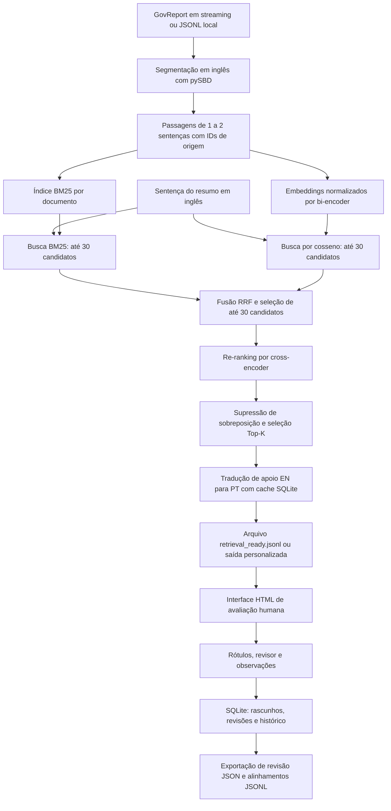

# Factual Injector UI

Ferramenta local para **alinhar sentenças de resumos a evidências de documentos e registrar avaliações humanas**. Desenvolvida para revisão de evidências recuperadas do GovReport, com textos em inglês e tradução de apoio em português.

A interface principal usa HTML, CSS e JavaScript, com um servidor Python e persistência em SQLite. Os modelos são executados na preparação dos dados; abrir e anotar um arquivo já preparado não exige GPU, Streamlit ou downloads de modelos.

Apesar do nome do projeto, o fluxo atual é de recuperação e anotação de evidências. A versão presente não executa injeção automática de erros factuais.

## Fluxo do projeto



A recuperação e o re-ranking usam os textos em inglês. A tradução acontece depois da seleção de evidências e não interfere no ranking. Na etapa de anotação, a interface lê o JSONL pronto sem executar modelos. Com `--no-translation`, o pré-processador pula a tradução.

### Recuperação híbrida: BM25 + cosseno + RRF

O modo padrão é **`--retrieval-mode hybrid`**:

1. **BM25** busca correspondências lexicais nas mesmas passagens indexadas pelo bi-encoder.
2. **Bi-encoder + similaridade de cosseno** busca correspondências semânticas.
3. Cada busca fornece até `--pool-size` candidatos. O BM25 inclui somente passagens com score positivo.
4. **Reciprocal Rank Fusion (RRF)** combina as posições nos dois rankings. A união contém até duas vezes o pool; somente os primeiros `--pool-size` candidatos combinados seguem para o cross-encoder.
5. **Cross-encoder** reordena esse pool por relevância. A seleção final elimina sobreposição de sentenças e retorna até `--top-k` evidências.

A fusão tem pesos iguais e utiliza:

```text
RRF(passagem) = soma de 1 / (rrf_k + posição)
```

As posições começam em 1, com `--rrf-k 60` por padrão. Uma passagem ausente em um ranking recebe contribuição zero daquele ranking. Os scores brutos de BM25 e cosseno não são somados. Se não houver correspondência lexical, a ordem de seleção permanece a da busca densa. Empates na fusão são resolvidos pelo cosseno e pela ordem original das passagens.

O BM25 é uma implementação local de Okapi com IDF positiva, `k1=1.5` e `b=0.75`. O índice é construído uma vez por documento, sobre as passagens, incluindo janelas. A tokenização normaliza maiúsculas/minúsculas e preserva números, termos com hífen e apóstrofos; não utiliza stemming nem remoção de stopwords. Não exige serviço de busca nem dependência adicional.

Para comparar a recuperação híbrida com a recuperação somente por cosseno, prepare a mesma amostra em saídas separadas:

```bash
python src/pre_processor.py --limit 2 --split test --offset 0 \
  --retrieval-mode hybrid --pool-size 30 --rrf-k 60 --device cpu \
  --output data/processed/amostra_hibrida.jsonl

python src/pre_processor.py --limit 2 --split test --offset 0 \
  --retrieval-mode dense --pool-size 30 --device cpu \
  --output data/processed/amostra_densa.jsonl

python app/retrieval_html.py --input data/processed/amostra_hibrida.jsonl --open
```

O modo `dense` mantém a seleção inicial por cosseno, sem BM25 ou fusão, com o mesmo re-ranking e supressão de sobreposição. A comparação exige o mesmo snapshot dos dados, modelos e configuração restante. O ganho deve ser medido com evidências humanas, por exemplo Recall@3/5; a presença do BM25 não garante melhoria em todos os documentos.

**Arquivos preparados anteriormente não passam a usar BM25 ao abrir a interface.** Gere um novo JSONL para executar o novo fluxo, preservando a entrada original e suas revisões.

## Início rápido

Para abrir os dados já preparados, basta Python 3.10 ou superior:

```bash
cd ~/factual-injector-ui
python3 app/retrieval_html.py --open
```

Acesse **http://127.0.0.1:8766/** se o navegador não abrir automaticamente. Mantenha o terminal aberto enquanto trabalha; use `Ctrl+C` para encerrar. Para continuar depois, execute o mesmo comando.

Se preferir utilizar o ambiente Conda `agentes`, com Python instalado:

```bash
cd ~/factual-injector-ui
conda activate agentes
python app/retrieval_html.py --open
```

Não é necessário instalar `requirements.txt` para esse fluxo: o servidor HTML utiliza somente a biblioteca padrão do Python. O arquivo de entrada padrão é `data/processed/retrieval_ready.jsonl`. A versão atualmente incluída contém 113 sentenças de resumo de cinco documentos; essas quantidades dependem dos dados, não são limites da ferramenta.

## Fluxo de anotação

1. Escolha uma sentença na fila. Use a busca em português, inglês ou pelo identificador e os filtros de documento e situação.
2. Leia a sentença do resumo e os candidatos recuperados. Alterne entre português, inglês e visualização bilíngue conforme necessário.
3. Avalie cada evidência como **Apoio**, **Contradição** ou **Nenhum/Irrelevante**. Nenhuma opção vem marcada na interface HTML.
4. Preencha a identificação do revisor e as observações. As alterações são salvas automaticamente como rascunho.
5. Após avaliar todos os candidatos, clique em **Concluir e próxima**. Alterar uma decisão ou observação reabre a revisão como rascunho.

Os controles **Top-1**, **Top-3** e **Top-5** alteram apenas quantas evidências aparecem na tela. O padrão é Top-5; **Todas** aparece quando há mais de cinco candidatos. A escolha permanece durante a sessão, sem alterar ranking, scores ou rótulos. Para concluir uma revisão, é necessário avaliar todos os candidatos da entrada, inclusive os ocultos pelo filtro de visualização.

O painel acompanha revisões não iniciadas, em andamento e concluídas. **Continuar pendências** inclui rascunhos. A interface também oferece tema claro/escuro e estes atalhos:

| Atalho | Ação |
| --- | --- |
| `J` / `K` | Próxima / anterior |
| `N` | Próxima pendência |
| `/` | Focar a busca |

Os atalhos não atribuem rótulos e ficam inativos durante a digitação.

### Pontuações exibidas nas evidências

Cada cartão de evidência apresenta **Cosseno (bi-encoder)**, **BM25**, **Fusão RRF** e **Re-ranking (cross-encoder)**. As posições nas buscas densa e lexical aparecem quando disponíveis. A evidência continua na ordem do re-ranking; os cartões não alteram o ranking nem as decisões humanas.

Cosseno, BM25 e re-ranking aparecem com quatro casas decimais; RRF utiliza seis para preservar diferenças pequenas. Zero e scores negativos válidos são exibidos normalmente. As escalas são diferentes: esses valores não são porcentagens nem probabilidades de veracidade. Abra **Como ler as pontuações de recuperação** para consultar a explicação de cada etapa.

Arquivos antigos sem BM25/RRF mostram **Não disponível**, sem inventar ou recalcular scores. No modo `dense`, essas etapas aparecem como **Não utilizado**. Para obter todas as pontuações, prepare uma nova entrada com `--retrieval-mode hybrid` e abra esse JSONL na interface. Recarregue a página para carregar a versão atualizada da interface.

## Salvamento e retomada

No modo servidor, as revisões ficam em **`data/annotations/retrieval.sqlite3`**. Aguarde a indicação **Salvo no computador ✓** antes de fechar a página ou encerrar o serviço.

O banco utiliza transações e controle de versão por revisão. Cada gravação gera também um evento de histórico na mesma transação. Bancos antigos são migrados automaticamente, preservando o estado atual como primeiro evento; alterações anteriores à migração não podem ser reconstruídas. Se outra aba modificar a mesma análise, a gravação desatualizada é recusada. Exporte a cópia da aba antes de recarregar para preservar alterações ainda não gravadas.

A identidade da entrada é o SHA-256 dos bytes do JSONL. Qualquer alteração no arquivo, inclusive na formatação, cria outra identidade de revisão. Para retomar o mesmo trabalho, preserve **o arquivo de entrada original e o banco SQLite**. Encerre o serviço antes de copiar o banco para backup.

Para exportar o histórico completo da entrada atual, incluindo rascunhos e versões anteriores:

```bash
python app/retrieval_html.py --export-history data/annotations/historico.json
```

O comando usa o banco e a entrada selecionados por `--database` e `--input`. Um arquivo de destino existente é recusado. Essa exportação é para auditoria, diferente do JSON de revisão usado na importação da interface.

### Caminhos e porta personalizados

```bash
python app/retrieval_html.py \
  --input data/processed/retrieval_ready.jsonl \
  --database data/annotations/retrieval.sqlite3 \
  --port 8766 \
  --open
```

| Opção | Finalidade | Padrão |
| --- | --- | --- |
| `--input` | Arquivo JSONL preparado | `data/processed/retrieval_ready.jsonl` |
| `--database` | Banco SQLite das revisões | `data/annotations/retrieval.sqlite3` |
| `--port` | Porta do servidor local | `8766` |
| `--open` | Abrir o navegador ao iniciar | Desativado |
| `--export-history` | Exportar histórico da entrada em JSON | Sem exportação |
| `--export-html` | Gerar HTML portátil e encerrar | Sem exportação |

Os caminhos padrão são resolvidos a partir da raiz do projeto. Caminhos relativos informados nos argumentos são relativos ao diretório de execução. O servidor atende em `127.0.0.1`.

## Exportação e importação

| Ação na interface | Resultado |
| --- | --- |
| **Exportar revisão completa (.json)** | Baixa `revisao_evidencias.json`, incluindo rascunhos, rótulos, notas e identificação do revisor. |
| **Importar revisão (.json)** | Restaura revisões do mesmo arquivo de entrada, após confirmação. Substitui as análises correspondentes e mantém as demais. |
| **Exportar alinhamentos concluídos (.jsonl)** | Baixa `aligned_evidence.jsonl` somente com revisões concluídas. |

Os alinhamentos exportados contêm `doc_id`, `summary_sentence_id`, `summary_sentence_en` e `validated_evidences`. Cada evidência mantém `doc_sent_id`, `text_en` e `human_label`, com os valores:

- `Apoio (Support)`
- `Contradição (Contradiction)`
- `Nenhum/Irrelevante`

`validated_evidences` inclui somente apoio e contradição. O campo `evidence_judgments` preserva todas as avaliações, inclusive irrelevantes. A exportação também inclui `reviewer`, `notes`, `review_status` e `input_sha256`.

Os botões baixam os arquivos pelo navegador; não substituem automaticamente os arquivos de `data/gold_standard/`. Para retomar rascunhos e decisões completas em outra instalação, utilize a exportação de revisão `.json`.

### HTML portátil

Para gerar um arquivo que pode ser aberto diretamente, sem manter o servidor ativo:

```bash
python app/retrieval_html.py --export-html data/processed/avaliacao.html
```

O arquivo incorpora os dados de entrada e uma cópia das revisões existentes no banco selecionado. Um destino já existente é recusado; escolha outro nome para gerar uma nova cópia.

**No modo portátil, as alterações ficam no armazenamento do navegador.** Exporte a revisão em JSON para manter uma cópia em disco ou transferi-la para outra origem/navegador. Para gravação automática no SQLite, use o servidor local.

## Preparação de novos dados

Essa etapa baixa o GovReport e os pesos dos modelos quando ainda não estão disponíveis em cache. Ela exige as dependências de aprendizado de máquina e consome mais memória que a interface de anotação.

Para manter as dependências fixadas em um ambiente próprio, use Python 3.11:

```bash
cd ~/factual-injector-ui
python3.11 -m venv .venv
source .venv/bin/activate
python -m pip install --upgrade pip
python -m pip install -r requirements.txt
```

Se o Python 3.11 estiver no ambiente Conda `agentes`, ative-o antes de criar a `.venv`:

```bash
conda activate agentes
python -m venv .venv
source .venv/bin/activate
```

Prepare uma amostra e depois abra a interface:

```bash
python src/pre_processor.py --limit 5 --split test --top-k 5 --device auto \
  --output data/processed/nova_amostra.jsonl
python app/retrieval_html.py --input data/processed/nova_amostra.jsonl --open
```

| Opção do pré-processador | Finalidade | Padrão |
| --- | --- | --- |
| `--limit` | Quantidade de documentos iniciais do split | `5` |
| `--split` | `train`, `validation` ou `test` | `test` |
| `--top-k` | Quantidade final de candidatos por sentença | `5` |
| `--offset` | Quantidade de documentos iniciais a pular | `0` |
| `--pool-size` | Limite de cada busca e do pool combinado enviado ao re-ranking | `30` |
| `--retrieval-mode` | `hybrid` (BM25 + cosseno + RRF) ou `dense` (cosseno) | `hybrid` |
| `--rrf-k` | Constante positiva de suavização da RRF, usada no modo híbrido | `60` |
| `--max-window` | Tamanho máximo das passagens: 1, 2 ou 3 sentenças | `2` |
| `--bi-encoder` | Modelo de embeddings | `sentence-transformers/all-MiniLM-L6-v2` |
| `--input` | JSONL local com `report`, `summary` e `id` opcional | GovReport quando omitido |
| `--cache` | Cache SQLite de traduções | `data/cache/translations.sqlite3` |
| `--no-translation` | Preparar somente inglês | Desativado |
| `--overwrite` | Autorizar substituir a saída existente | Desativado |
| `--device` | `auto`, `cpu` ou `cuda` | `auto` |
| `--output` | Destino do JSONL preparado | `data/processed/retrieval_ready.jsonl` |

`auto` seleciona CUDA quando disponível. Para executar em CPU, use `--device cpu`. O comando com `--device cuda` falha explicitamente se CUDA estiver indisponível.

### Executar na GPU NVIDIA

Ative o ambiente do projeto e confirme que CUDA está disponível:

```bash
cd ~/factual-injector-ui
conda activate agentes
source .venv/bin/activate
nvidia-smi
python -c "import torch; print('CUDA disponível:', torch.cuda.is_available()); print('GPU:', torch.cuda.get_device_name(0) if torch.cuda.is_available() else 'indisponível')"
```

Com CUDA disponível, prepare a amostra híbrida na GPU:

```bash
python src/pre_processor.py \
  --limit 2 \
  --retrieval-mode hybrid \
  --pool-size 10 \
  --top-k 5 \
  --device cuda \
  --output data/processed/amostra_hibrida_gpu.jsonl
```

O bi-encoder, o cross-encoder e o tradutor utilizam CUDA. A busca BM25, a fusão RRF e a seleção por cosseno sobre os embeddings NumPy continuam na CPU. A interface HTML apenas lê o resultado e não necessita de GPU.

Depois que a preparação terminar, abra a nova entrada:

```bash
python app/retrieval_html.py \
  --input data/processed/amostra_hibrida_gpu.jsonl \
  --open
```

Acesse **http://127.0.0.1:8766/**. O pré-processador só publica o JSONL depois de concluir o lote. Se o destino já existir, escolha outro nome ou use `--overwrite` quando desejar substituí-lo; uma nova entrada não reaproveita automaticamente revisões antigas.

O aviso `You seem to be using the pipelines sequentially on GPU` é uma orientação de desempenho do Transformers: o tradutor é chamado repetidamente ao processar as sentenças, embora cada chamada já agrupe os textos selecionados em pequenos lotes. O aviso, isoladamente, não indica falha nem execução em CPU; se o progresso continuar, deixe a preparação terminar. O agrupamento das traduções de várias sentenças em lotes maiores ainda não foi implementado.

### Pipeline implementado

1. Carrega uma amostra do GovReport em streaming, respeitando `--offset` e `--limit`, ou documentos de um JSONL local.
2. Segmenta relatório e resumo com pySBD, preservando sentenças curtas e IDs na ordem original. Um fallback regex está disponível se pySBD estiver ausente; para pesquisa, instale as dependências recomendadas.
3. Constrói passagens de uma e duas sentenças adjacentes, por padrão, com IDs de origem rastreáveis.
4. Indexa as passagens em BM25 e calcula embeddings normalizados uma vez por documento. Recupera até 30 candidatos por busca, combina por RRF e envia até 30 ao re-ranking, conforme `--pool-size`.
5. Reordena com `cross-encoder/ms-marco-MiniLM-L6-v2` e seleciona o Top-K, suprimindo passagens que compartilham sentenças com evidências já escolhidas. Empates têm ordenação determinística.
6. Traduz somente os textos selecionados com OPUS-MT, em lotes de até quatro, reutilizando o cache SQLite por texto e modelo. O tradutor só é carregado se houver textos sem cache.
7. Publica o JSONL completo após terminar o lote. Destinos existentes exigem `--overwrite`; falhas preservam a saída anterior.

A supressão de sobreposição pode resultar em menos de K evidências. O pool deve ser maior ou igual ao Top-K. A opção `--max-window 1` restringe a recuperação a sentenças isoladas. Para experimentar o modelo do outro projeto, use `--bi-encoder sentence-transformers/all-mpnet-base-v2`; isso muda o ranking e exige download adicional, sem garantia automática de melhoria.

Cada candidato novo registra `bi_encoder_score` (cosseno), `cross_encoder_score` (relevância), `bm25_score`, `rrf_score`, `dense_rank` e `bm25_rank`. Os ranks indicam a posição em cada lista inicial; `null` significa ausência naquela lista. No modo `dense`, `bm25_score` é zero e `rrf_score`/`bm25_rank` são `null`. O registro `retrieval_config` identifica modo, pool, constante RRF, parâmetros BM25, tokenização e modelos. As pontuações são apresentadas nos cartões de evidência da interface.

Textos que excedem o limite de tokens da tradução recebem um aviso explícito para consultar o original inglês. Falhas de tradução interrompem a preparação, sem armazenar o inglês como se fosse tradução; os lotes já traduzidos permanecem no cache para a próxima execução. Para preparar sem carregar o tradutor, use `--no-translation`.

Os dados existentes não são convertidos automaticamente: uma nova preparação gera outra identidade de entrada e deve receber novas avaliações. O layout HTML e os rótulos continuam compatíveis com os arquivos antigos.

Para preservar uma entrada já anotada, gere um novo arquivo:

```bash
python src/pre_processor.py \
  --limit 2 --split test --top-k 5 --device cpu \
  --output data/processed/nova_amostra.jsonl

python app/retrieval_html.py --input data/processed/nova_amostra.jsonl --open
```

### Formato da entrada

Cada linha do JSONL representa uma sentença do resumo e seus candidatos. Exemplo ilustrativo:

```json
{
  "doc_id": "govreport_test_00000",
  "summary_sentence_id": "govreport_test_00000_sum_0",
  "summary_sentence_en": "The program served 200 schools.",
  "summary_sentence_pt": "O programa atendeu 200 escolas.",
  "retrieved_top_k": [
    {
      "doc_sent_id": "P_0012_0013",
      "source_sentence_ids": ["SRC_0012", "SRC_0013"],
      "start_index": 12,
      "end_index": 13,
      "text_en": "In that year, 200 schools participated in the program.",
      "text_pt": "Naquele ano, 200 escolas participaram do programa.",
      "bi_encoder_score": 0.82,
      "cross_encoder_score": 4.1
    }
  ],
  "dataset": "ccdv/govreport-summarization",
  "split": "test"
}
```

Os scores acima são fictícios. `summary_sentence_id` deve ser único no arquivo; `doc_sent_id` deve ser único entre os candidatos de cada sentença. A interface valida identificadores, textos e estrutura antes de iniciar.

## Estrutura do projeto

```text
app/
  retrieval_html.py          Servidor local, validação e persistência SQLite
  templates/retrieval.html   Interface HTML/CSS/JavaScript
  retrieval_ui.py            Interface Streamlit anterior
src/
  pre_processor.py          CLI e adaptação para o formato da interface
  evidence/                 Dataset, segmentação, BM25, recuperação híbrida e cache de tradução
data/
  processed/                Entradas JSONL e HTML portátil opcional
  annotations/              Banco de revisões e histórico, criado ao executar
  cache/                    Cache persistente das traduções
  gold_standard/            Arquivos de referência existentes
tests/
  test_retrieval_html.py          Testes de persistência e validação
  test_retrieval_html_browser.py  Integração opcional com navegador
requirements.txt            Dependências do pré-processamento e Streamlit
```

### Interface Streamlit anterior

O módulo anterior permanece disponível para quem precisa desse fluxo:

```bash
python -m streamlit run app/retrieval_ui.py
```

Ele exige as dependências de `requirements.txt`, lê o mesmo JSONL e acrescenta alinhamentos em `data/gold_standard/aligned_evidence.jsonl`. Esse fluxo não usa o banco de revisões da interface HTML e apresenta **Nenhum/Irrelevante** como seleção inicial. Para anotações com escolhas explícitas, rascunhos e retomada, utilize a interface HTML descrita acima.

## Testes

Os testes unitários usam dados e bancos temporários, sem carregar modelos:

```bash
python -B -m unittest discover -s tests -v
```

A suíte cobre persistência, retomada, avaliações explícitas, conflitos de versão, importação atômica, isolamento entre entradas, identificadores duplicados e preservação dos textos no HTML. Os testes adicionais do pipeline usam doubles de modelos e verificam janelas, deduplicação, cache, offset, publicação atômica, compatibilidade com a interface e migração do histórico. Os testes de BM25/RRF verificam a fórmula, normalização por comprimento, tokenização, ausência de termos, fusão por posição, resgate de candidato fora do pool denso, limite do pool e desempate determinístico. Requerem NumPy; ficam desativados se ele não estiver instalado. Nesse comando, os testes de navegador ficam desativados por padrão.

Para executar a integração opcional, disponibilize Firefox, geckodriver e Selenium no ambiente e habilite:

```bash
FACTUAL_INJECTOR_BROWSER_TESTS=1 python -B -m unittest discover -s tests -p '*browser.py' -v
```

Esses testes verificam interações de anotação, importação/exportação, navegação e controles Top-K. A suíte não mede a qualidade da recuperação nem valida inferência dos modelos.

## Problemas frequentes

| Sintoma | Como resolver |
| --- | --- |
| Entrada ausente ou inválida | Confira `--input` ou gere um JSONL com o pré-processador. |
| Porta 8766 ocupada | Execute com outra porta, por exemplo `--port 8767`. |
| `python3.11: command not found` | Use um ambiente que tenha Python 3.11 instalado; para abrir somente o HTML, Python 3.10+ é suficiente. |
| `pyarrow requires NumPy 2.0 or newer` | Reinstale as dependências com `python -m pip install -r requirements.txt`. O projeto fixa `pyarrow==16.1.0` para manter compatibilidade com NumPy 1.26 e `datasets==2.18.0`. |
| Destino de preparação já existe | Escolha um novo `--output` ou use `--overwrite` quando a substituição for intencional. |
| CUDA indisponível | Verifique `nvidia-smi` e `torch.cuda.is_available()` no mesmo ambiente. `--device cuda` exige driver e PyTorch com suporte a CUDA; para continuar sem GPU, use `--device cpu`. |
| `pipelines sequentially on GPU` | Aviso de desempenho do tradutor. Se o contador de sentenças continuar avançando, aguarde a conclusão. |
| Falha ao baixar dataset ou modelos | Verifique o acesso ao Hugging Face e execute novamente a preparação. |
| Conflito de revisão ou solicitação para recarregar | Exporte a revisão da aba e reabra o endereço local do servidor. |
| Revisões não aparecem após trocar a entrada | Restaure o JSONL original e selecione o mesmo banco SQLite. A identidade depende dos bytes da entrada. |

## Limites metodológicos

- A unidade de anotação é a sentença do resumo; não há extração de claims atômicas no fluxo atual.
- A interface recebe somente os candidatos recuperados, sem o documento-fonte integral. As janelas e a deduplicação são escolhas de recuperação, sem validação automática de recall. O Top-K não garante cobertura de todas as evidências existentes.
- Scores de BM25, cosseno, RRF e cross-encoder são sinais de correspondência ou relevância. Não representam probabilidade de veracidade nem decisão de entailment.
- Uma evidência irrelevante não demonstra que a sentença é falsa. A ausência de apoio entre os candidatos também não demonstra ausência no documento.
- A tradução é um apoio de leitura. Confira o inglês original ao tomar decisões.
- Uma revisão concluída registra a avaliação dos candidatos apresentados. Não produz automaticamente um julgamento factual global ou um gold standard validado.
- O antigo `validated_dataset.jsonl` e anotações de outros projetos não são importáveis como revisões sem uma conversão de esquema explícita.

As novas evidências também contêm `source_sentence_ids`, `start_index` e `end_index`. Esses campos acompanham a exportação HTML de alinhamentos quando presentes. Cada registro novo inclui `retrieval_config` e `source_offset` para documentar a preparação.
